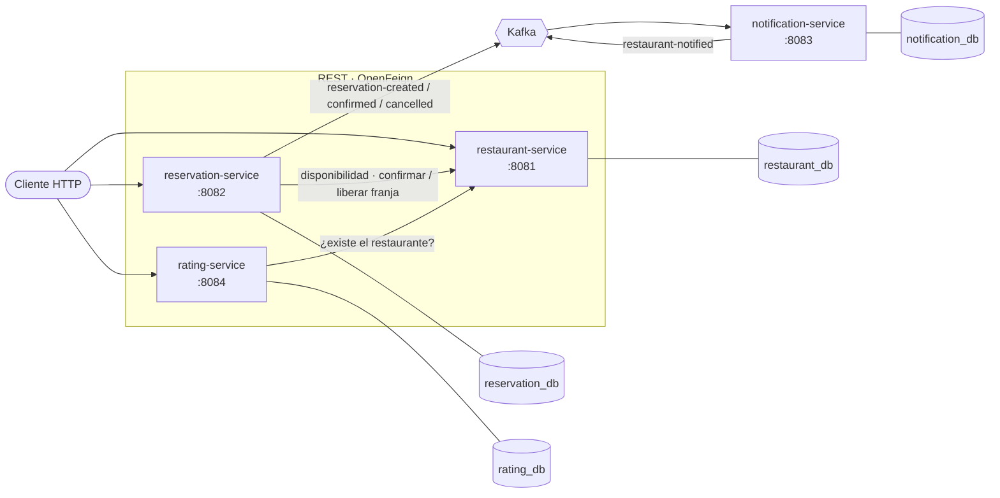

# Restaurant Reservation · Microservicios

Sistema de reservas de restaurantes construido con **cuatro microservicios Spring Boot** que se comunican por **REST (OpenFeign)** y por **eventos en Kafka**. Cada servicio tiene su propia base de datos PostgreSQL, sus migraciones con Flyway y su `compose.yml`.

Proyecto en grupo de la asignatura **Sistemas Distribuidos** (Universidade Lusófona).

---

## Arquitectura



| Servicio | Puerto | Responsabilidad |
|---|---|---|
| [`restaurant-service`](restaurant-service) | 8081 | Restaurantes, menús y platos, franjas horarias y control de disponibilidad (reservar y liberar plazas). |
| [`reservation-service`](reservation-service) | 8082 | Ciclo de vida de las reservas (crear, confirmar, cancelar, consultar por fecha, estado o restaurante). Comprueba la disponibilidad contra `restaurant-service` y publica eventos. |
| [`notification-service`](notification-service) | 8083 | Consume los eventos de reservas, guarda las notificaciones y publica `restaurant-notified-events`. |
| [`rating-service`](rating-service) | 8084 | Reseñas y resumen de puntuaciones por restaurante; valida que el restaurante existe y que el cliente no lo haya reseñado ya. |

### Decisiones de diseño

- **Base de datos por servicio.** Ningún servicio lee la base de otro; se comunican solo por API o eventos.
- **Síncrono cuando hace falta una respuesta**, como la disponibilidad de una franja antes de confirmar una reserva (OpenFeign con *timeouts* configurados).
- **Asíncrono para los efectos secundarios**, como las notificaciones: Kafka con mensajes en JSON y la clave de la reserva para mantener el orden por reserva.
- **Esquema versionado** con Flyway (`migrations/V*__*.sql`), aplicado por un contenedor antes de arrancar el servicio.

---

## Stack

| | |
|---|---|
| Lenguaje | Java · Spring Boot 3.4 |
| Web | Spring Web · Bean Validation · springdoc-openapi (Swagger UI) |
| Datos | Spring Data JPA · PostgreSQL 17 · Flyway 11 |
| Comunicación | Spring Cloud OpenFeign · Spring for Apache Kafka |
| Observabilidad | Spring Boot Actuator |
| Infraestructura | Docker · Docker Compose · Maven Wrapper |
| Utilidades | Lombok |

---

## Estructura

```
restaurant-service/     Restaurantes, menús, franjas y disponibilidad
reservation-service/    Reservas y eventos de reserva
notification-service/   Consumidor de eventos y notificaciones
rating-service/         Reseñas y puntuaciones
```

Cada servicio sigue la misma organización: `controller`, `service`, `repository`, `model`, `dto`, `mapper`, `client` (Feign), `events` (Kafka) y `exception`, más `migrations/`, `Dockerfile`, `compose.yml` y `.env.example`.

---

## Puesta en marcha

Requisitos: Docker con Docker Compose, y un broker de Kafka accesible en la red `restaurant-network`.

```bash
# 1. Red compartida por todos los servicios
docker network create restaurant-network

# 2. Variables de entorno de cada servicio (cambia las contraseñas)
for s in restaurant reservation rating notification; do
  cp $s-service/.env.example $s-service/.env
done

# 3. Arrancar cada servicio (base de datos + migraciones + aplicación)
for s in restaurant reservation rating notification; do
  (cd $s-service && docker compose up -d --build)
done
```

Con los servicios en marcha, la documentación interactiva de cada API está en `http://localhost:<puerto>/swagger-ui.html`, y el estado en `/actuator/health`.

### Ejemplos de endpoints

| Método | Ruta | Servicio |
|---|---|---|
| `GET` | `/api/restaurants/{id}` | restaurant |
| `GET` | `/api/restaurants/{id}/availability` | restaurant |
| `GET` `POST` | `/api/restaurants/slots`, `/api/restaurants/slots/available` | restaurant |
| `GET` | `/api/restaurants/menus` · `GET` `POST` `/api/restaurants/items` | restaurant |
| `PATCH` | `/api/reservation/{id}/confirm`, `/api/reservation/{id}/cancel` | reservation |
| `GET` | `/api/reservation/date/{date}`, `/api/reservation/status/{status}` | reservation |
| `GET` | `/api/ratings/restaurant/{restaurantId}/summary` | rating |

---

## Autores

Desarrollado en equipo por tres estudiantes. El historial de commits conserva la autoría original de cada parte.

- Daniel Peralta Llamas · [@DanielPeraltaLlamas](https://github.com/DanielPeraltaLlamas)
- Rafa Ceres Martínez · [@Garfa9909](https://github.com/Garfa9909)
- Manuel Albizu · [@ManuelAlbizu](https://github.com/ManuelAlbizu)
